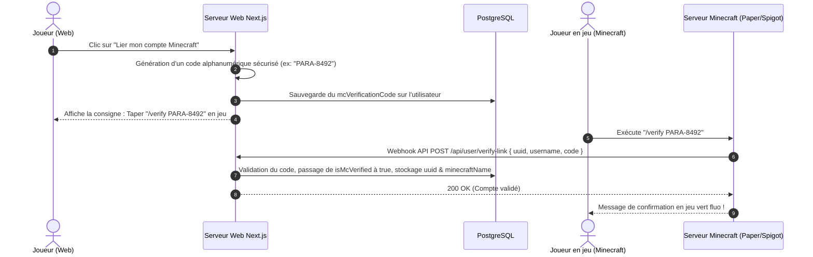

# 🛡️ Règles Métier — Sécurité, Liaison Mojang & HWID Launcher

La sécurité du serveur Paranoia repose sur une synchronisation tripartite : **Discord OAuth2 ↔ Compte Mojang Minecraft ↔ Empreinte Machine Launcher (HWID)**.

---

## 1. Processus de Liaison Mojang

Pour prouver que le joueur connecté sur le site est bien le propriétaire de son compte Minecraft :

---

## 2. Empreinte Machine Launcher (HWID)

Pour empêcher les joueurs bannis pour triche (x-ray, reach, fly) de recréer un compte alternatif et de revenir polluer l'expérience des autres :

### 2.1 Calcul du Hardware ID
Le Launcher dédié Paranoia génère un hash cryptographique non réversible combinant :
- Le numéro de série de la carte mère (BIOS UUID)
- L'ID matériel du disque système principal (Volume Serial Number)
- L'identifiant processeur (CPU ID).

### 2.2 Vérification au lancement du jeu (`/api/launcher/verify`)
1. Le launcher envoie :
   - `minecraftUuid`
   - `username`
   - `hwid`
   - Header secret `x-launcher-secret`.
2. Le backend vérifie :
   - Si un ban actif existe pour ce `uuid` ➔ **Refus immédiat**.
   - Si un ban actif existe pour ce `hwid` (même sous un autre pseudo) ➔ **Refus immédiat avec alerte "Double-compte détecté sur machine bannie"**.
3. Si tout est valide, une session de jeu temporaire est validée.

---

## 3. Gestion des Sanctions & Bans

L'entité `Ban` conserve l'historique complet pour garantir la justice et la traçabilité :
- `playerId` : Référence vers le joueur Minecraft
- `hwid` : Empreinte machine enregistrée au moment du ban
- `reason` : Motif explicite de la sanction
- `bannedBy` : Identifiant du membre du staff à l'origine du ban
- `bannedAt` : Horodatage
- `isActive` : Booléen (`true` tant que le ban n'est pas purgé ou révoqué)
- `unbannedAt` & `unbannedBy` : Métadonnées d'audit lors d'un débanissement.

---

## 4. Télémétrie & Crash Reports Automatiques

Lorsque le client Minecraft du joueur rencontre un crash critique :
- Le launcher intercepte le signal d'erreur de la Machine Virtuelle Java (JVM).
- Il envoie un rapport complet à `POST /api/telemetry/crash-report` :
  - `gpu`, `cpu`, `screenResolution`
  - `ramSystem`, `ramAllocated`
  - `osInfo` (Windows 11, Linux, macOS)
  - `jvmArgs`
  - `logs` (Stacktrace complète du crash)
- Les administrateurs peuvent consulter et filtrer ces rapports directement dans l'interface admin pour déployer des patchs correctifs.
