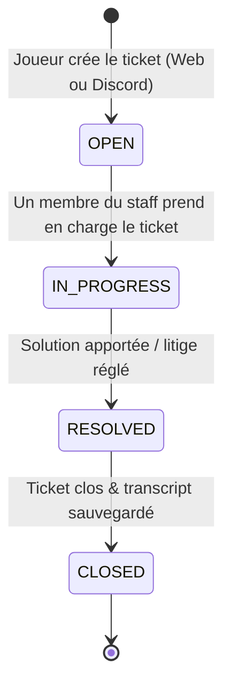
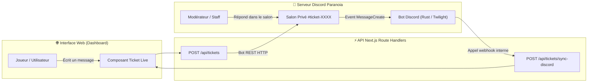

# 🎫 Règles Métier — Support & Tickets Hybrides (Web ↔ Discord)

Le système de support de Paranoia permet aux joueurs de contacter l'équipe d'assistance soit depuis le site web, soit depuis le serveur Discord officiel, avec une synchronisation bidirectionnelle immédiate.

---

## 1. Catégories de Tickets

Lors de l'ouverture d'un ticket, le joueur doit sélectionner l'une des catégories suivantes :

1. **Bug & Crash Launcher** : Problèmes de démarrage du jeu, plantages Java, écran noir.
2. **Signalement Joueur / Triche** : Suspicion de hack, comportement toxique, litige en jeu.
3. **Perte d'Item / Problème Compte** : Requête de rollback ou bug d'inventaire.
4. **Questions & Partenariats** : Demandes générales, créateurs de contenu.

---

## 2. Cycle de Vie d'un Ticket

---

## 3. Architecture de Synchronisation Bidirectionnelle

---

## 4. Règles de Clôture & Archivage

1. **Clôture via Discord** : Le staff tape `!close` dans le salon du ticket ou clique sur le bouton "Fermer le ticket".
2. **Clôture via le Web** : Le joueur ou le staff clique sur le bouton "Clôturer le ticket".
3. **Actions exécutées** :
   - Le statut passe à `CLOSED` en base de données.
   - L'historique complet (Transcript) est généré en HTML/Markdown et stocké.
   - Le salon Discord est supprimé après un compte à rebours de 5 secondes.
   - Une notification récapitulative est envoyée en message privé au joueur.
