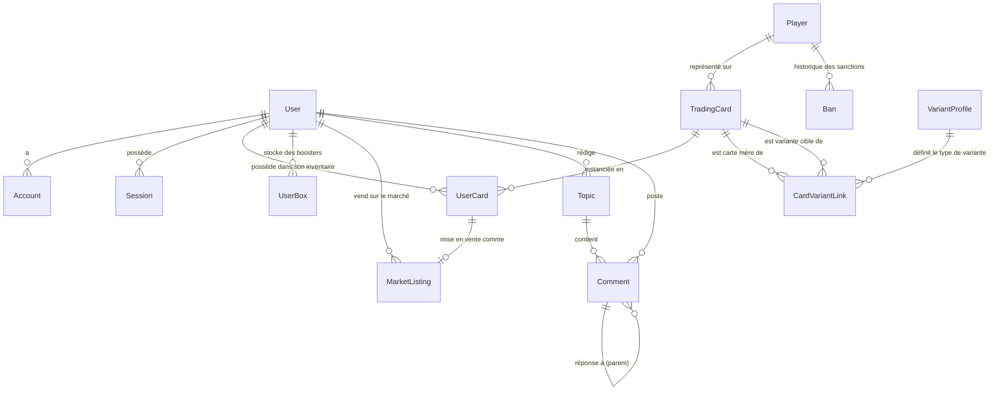

# 🗄️ Modélisation de la Base de Données — MCD & Relations

Ce document décrit la structure de données relationnelle de **Paranoia New**, son diagramme Entité-Association (MCD) et sa transcription au format **DBML** pour [dbdiagram.io](https://dbdiagram.io).

---

## 1. Entités Clés & Rôles

| Entité | Rôle & Description | Relations clés |
|---|---|---|
| **User** | Compte utilisateur web principal, solde Paracoins, niveau XP, statut de liaison Mojang. | Possède `UserCard[]`, `UserBox[]`, `MarketListing[]`, `Topic[]` |
| **Account / Session** | Tables de session NextAuth pour l'authentification OAuth2 Discord. | Rattachées à `User` (1-N) |
| **Player** | Fiche d'identité Minecraft (UUID Mojang, HWID machine, skin). | Relié à `TradingCard[]` (cartes à son effigie), `Ban[]` |
| **TradingCard** | Carte à collectionner (rareté, calques graphiques, badges, positions, édition). | Liée à `Player`, `UserCard[]`, `CardVariantLink[]` |
| **UserCard** | Exemplaire unique d'une carte dans l'inventaire d'un joueur, avec effet holographique éventuel. | N-1 avec `User` et `TradingCard`, 1-1 optionnel avec `MarketListing` |
| **UserBox** | Stock de boosters possédés par un joueur (`standard`, `premium`, `legendary`, `mythic`). | Liée à `User` (paire unique `userId` + `boxType`) |
| **MarketListing** | Offre de vente sur le marché communautaire entre joueurs. | Liée au vendeur `User` et à l'exemplaire `UserCard` |
| **CardVariantLink** | Lien d'évolution entre une carte mère et sa variante alternative. | Relie `motherCard`, `targetCard` et `VariantProfile` |
| **Ban** | Registre des sanctions actives et historiques (bannissements par joueur et par HWID). | Rattaché à `Player` |
| **BugReport** | Signalements de crash du launcher (specs système, versions, logs JVM). | Indépendant ou rattaché au joueur |
| **Topic / Comment** | Forum communautaire interne et commentaires hiérarchiques. | Rattachés à `User` |

---

## 2. Diagramme Conceptuel des Données (Mermaid ER)



---

## 3. Schéma DBML (Compatible dbdiagram.io)

> [!TIP]
> Tu peux copier-coller le bloc de code ci-dessous directement sur [dbdiagram.io](https://dbdiagram.io) pour visualiser et manipuler le schéma graphique interactif en direct.

```dbml
// Schéma DBML Paranoia New pour dbdiagram.io

Table users {
  id varchar [pk]
  name varchar
  email varchar [unique]
  emailVerified timestamp
  image varchar
  discordId varchar [unique]
  minecraftName varchar
  minecraftUuid varchar [unique]
  customSkinUrl varchar
  mcVerificationCode varchar [unique]
  isMcVerified boolean [default: false]
  role varchar [default: "MEMBER"]
  paraCoins integer [default: 0]
  xp integer [default: 0]
  level integer [default: 1]
  lastDaily timestamp
  createdAt timestamp [default: `now()`]
}

Table accounts {
  id varchar [pk]
  userId varchar [not null]
  type varchar [not null]
  provider varchar [not null]
  providerAccountId varchar [not null]
  refresh_token text
  access_token text
  expires_at integer
  token_type varchar
  scope varchar
  id_token text
  session_state varchar

  indexes {
    (provider, providerAccountId) [unique]
  }
}

Table players {
  id varchar [pk]
  minecraftName varchar [unique, not null]
  hwid varchar
  uuid varchar [unique]
  customSkinUrl varchar
  status varchar [default: "ACTIVE"]
  createdAt timestamp [default: `now()`]
  updatedAt timestamp
}

Table bans {
  id varchar [pk]
  playerId varchar [not null]
  hwid varchar
  reason text [not null]
  bannedBy varchar [not null]
  bannedAt timestamp [default: `now()`]
  isActive boolean [default: true]
  unbannedAt timestamp
  unbannedBy varchar
}

Table trading_cards {
  id varchar [pk]
  title varchar [not null]
  playerId varchar
  description text
  imageUrl varchar
  layer1Url varchar
  layer2Url varchar
  layer3Url varchar
  renderedImageUrl varchar
  customBackground varchar
  customBadges text [default: "[]"]
  characterPosition text [default: "{\"x\":50,\"y\":50,\"scale\":100}"]
  rarity varchar [default: "COMMON"]
  level varchar [default: "Normal"]
  edition varchar [default: "Standard"]
  proba float [default: 100]
  attributes text [default: "{}"]
  template varchar [default: "classic"]
  isPublished boolean [default: false]
  isVariant boolean [default: false]
  createdAt timestamp [default: `now()`]
  updatedAt timestamp
  authorId varchar [not null]
}

Table user_cards {
  id varchar [pk]
  userId varchar [not null]
  tradingCardId varchar [not null]
  obtainedAt timestamp [default: `now()`]
  specialEffect varchar
}

Table user_boxes {
  id varchar [pk]
  userId varchar [not null]
  boxType varchar [not null]
  amount integer [default: 0]

  indexes {
    (userId, boxType) [unique]
  }
}

Table market_listings {
  id varchar [pk]
  sellerId varchar [not null]
  userCardId varchar [unique, not null]
  price integer [not null]
  createdAt timestamp [default: `now()`]
}

Table variant_profiles {
  id varchar [pk]
  name varchar [unique, not null]
  iconUrl varchar
  createdAt timestamp [default: `now()`]
}

Table card_variant_links {
  id varchar [pk]
  motherCardId varchar [not null]
  variantProfileId varchar [not null]
  targetCardId varchar [not null]

  indexes {
    (motherCardId, variantProfileId) [unique]
  }
}

Table bug_reports {
  id varchar [pk]
  title varchar [not null]
  description text [not null]
  category varchar [default: "Crash"]
  status varchar [default: "OPEN"]
  accountName varchar
  profileName varchar
  minecraftVersion varchar
  graphicsMode varchar
  gpu varchar
  screenResolution varchar
  cpu varchar
  ramSystem varchar
  ramAllocated varchar
  osInfo varchar
  jvmArgs text
  javaPath varchar
  logs text
  createdAt timestamp [default: `now()`]
  updatedAt timestamp
}

// Relations
Ref: accounts.userId > users.id [delete: cascade]
Ref: bans.playerId > players.id [delete: cascade]
Ref: trading_cards.playerId > players.id
Ref: trading_cards.authorId > users.id
Ref: user_cards.userId > users.id [delete: cascade]
Ref: user_cards.tradingCardId > trading_cards.id [delete: cascade]
Ref: user_boxes.userId > users.id [delete: cascade]
Ref: market_listings.sellerId > users.id [delete: cascade]
Ref: market_listings.userCardId - user_cards.id [delete: cascade]
Ref: card_variant_links.motherCardId > trading_cards.id [delete: cascade]
Ref: card_variant_links.targetCardId > trading_cards.id [delete: cascade]
Ref: card_variant_links.variantProfileId > variant_profiles.id [delete: cascade]
```
