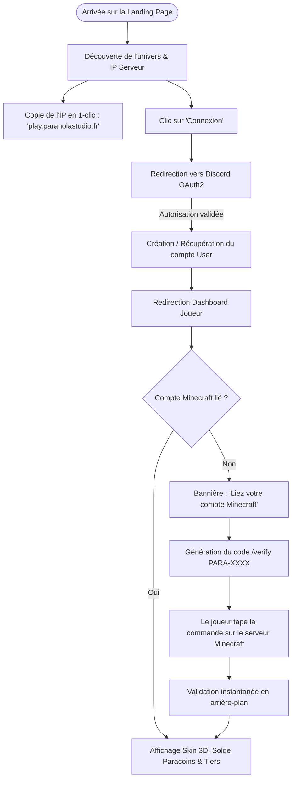
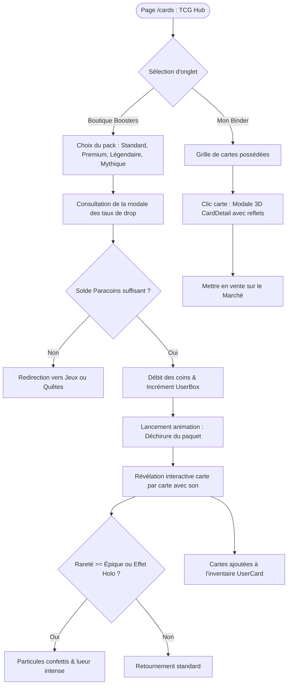
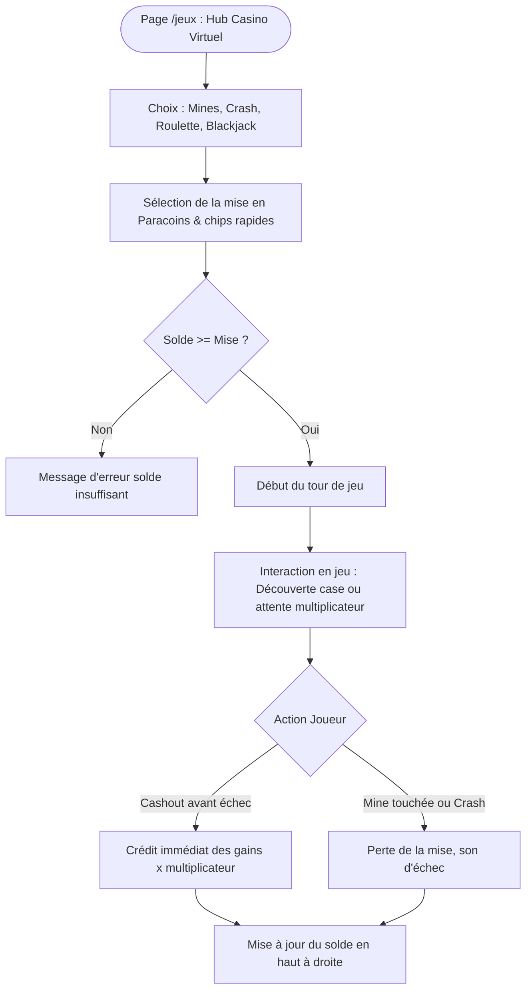

# 🗺️ Parcours Utilisateurs — User Flows

Ce document cartographie les flux de navigation et les décisions clés des utilisateurs à travers la plateforme Paranoia.

---

## 1. Flux Principal : Onboarding, Connexion & Liaison Minecraft

---

## 2. Flux TCG : Achat, Ouverture de Booster & Collection

---

## 3. Flux Mini-Jeux : Mise, Action & Retrait (Mines / Crash)

