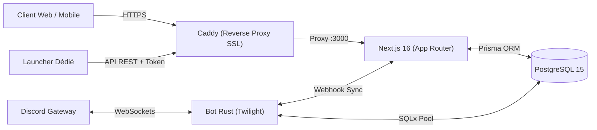

# 🏗️ Architecture Technique — Choix de Stack & Arbitrage

Ce document analyse les options d'architecture pour **Paranoia New** et motive le choix final retenu.

---

## 1. Comparatif des Approches Architecturales

| Critère | Option A : Monolithe Next.js Fullstack (App Router) | Option B : Frontend Découplé (React/Vite) + API Dédiée (Rust / Express) | Option C : Architecture Hybride Recommandée |
|---|---|---|---|
| **Structure** | Next.js gère à la fois les pages React, le SSR, les Server Actions et les Route Handlers `/api`. | Une SPA React statique + une API REST/gRPC séparée (ex: Axum en Rust ou Fastify en Node). | Next.js 16 pour le Web/SSR/API REST métier + Microservice Rust indépendant pour le Bot Discord (Twilight). |
| **Complexité de Dev** | Faible à Moyenne (un seul repo, un seul package.json, types TypeScript partagés front/back). | Élevée (deux repos ou monorepo lourd, duplication de types TS/Rust, CORS à gérer). | Optimale : le web reste simple et unifié, le bot Rust excelle là où Node.js peine (Gateway Discord persistante). |
| **Performance TCG & Mini-Jeux** | Excellente : calculs rapides en Node.js, transactions atomiques Prisma PostgreSQL. | Maximale sur l'API Rust, mais gain négligeable pour du trafic Web classique (quelques ms). | Excellente pour l'UI et les transactions ; ultra-réactif pour les événements Discord. |
| **SEO & SSR** | Natif avec Next.js App Router (rendu des cartes, profils des joueurs pour les crawlers). | Nécessite un serveur de prerendering ou abandon du SEO (client-only). | Natif pour la vitrine, les profils de joueurs et les fiches de cartes. |

---

## 2. Recommandation & Décision Finale : Architecture Hybride

Nous retenons l'**Architecture Hybride (Option C)** pour Paranoia New :

1. **Plateforme Web Principale (`Next.js 16 App Router`)** :
   - Frontend en **React 19 + TypeScript + Tailwind CSS**.
   - Backend via **Route Handlers Next.js (`src/app/api/*`)** et **Prisma ORM** connecté à PostgreSQL.
   - Validation stricte des payloads via **Zod**.
   - Authentification gérée par **NextAuth.js v4/v5** avec le provider Discord.
   
2. **Service Événementiel Discord (`bot-rust` en Rust / Twilight)** :
   - Développé en Rust avec le framework haute performance `twilight`.
   - Se connecte directement au Gateway Discord pour écouter les messages des tickets, la modération et la gestion vocale.
   - Partage la base de données PostgreSQL via **SQLx**.
   - Appelle les endpoints internes Next.js via des webhooks sécurisés par un token d'authentification (`x-bot-secret`).

---

## 3. Schéma Global des Échanges

